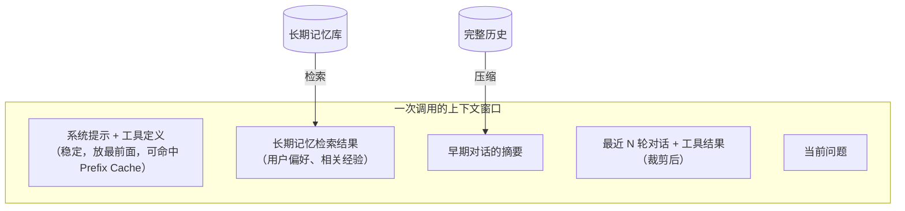

# 记忆与上下文工程

> 频率：★★★ · 近两年出现在：阿里（短期/长期记忆、上下文溢出）、腾讯（Skill 按需加载、Prefix Cache、上下文压缩、长 Tool Result） · 参考：[Anthropic：Effective context engineering for AI agents](https://www.anthropic.com/engineering/effective-context-engineering-for-ai-agents)

## 一句话答案

**上下文工程**是决定每次调用模型时窗口里放什么：系统提示、工具定义、相关的记忆和检索结果、最近的对话和工具结果。上下文是有限且昂贵的资源，放得越多越贵、越慢，而且模型对长上下文中间部分的注意力会下降。**短期记忆**是当前会话的消息历史，靠滑动窗口和**摘要压缩**控制长度；**长期记忆**是跨会话保存的用户偏好、事实和经验，存在数据库或向量库里，需要时**检索**进上下文。

## 展开（1–2 分钟能讲完）

**记忆的分类**：

| 类型 | 内容 | 存储 | 怎么用 |
|---|---|---|---|
| 工作记忆 | 当前任务的消息、工具结果 | 内存 / Redis | 直接放上下文，超长时压缩 |
| 会话摘要 | 早期对话的压缩版本 | Redis / DB | 放在上下文开头 |
| 长期记忆 | 用户偏好、事实、项目约定 | DB + 向量库 | 按相关性检索、或者固定加载少量核心内容 |
| 外部知识 | 文档、代码 | 向量库、搜索 | RAG、工具按需读取 |

**控制上下文长度的手段**：

- **压缩**：接近上限时，把较早的消息总结成摘要，保留关键决策、未完成的事项、重要的事实，丢掉冗长的工具输出。
- **工具结果裁剪**：工具返回的大段内容（文件、网页、日志）在用完后替换成简短的说明或者引用（「已读取 a.py，共 300 行」），需要时再读。
- **按需加载**：不是一开始就把所有文档、所有工具描述塞进去，而是让 Agent 通过工具按需获取（**just-in-time**），上下文里只放索引或文件路径。
- **结构化笔记**：让 Agent 把进度、待办写进外部文件（todo 列表、笔记），上下文被压缩后还能读回来。
- **子 Agent**：把需要大量探索的子任务交给一个有独立上下文的子 Agent，只返回结论。

## 图解

## 追问链

- **上下文压缩同步做还是异步做？** **同步**：在即将超出上限时，当前请求先等压缩完成再调用模型，实现简单、总是基于最新的内容，但这一轮的延迟明显增加（多一次模型调用）。**异步**：在后台提前压缩（比如每隔几轮或者达到上限的 70% 时就开始），用户请求时直接用已经压缩好的版本 + 之后新增的消息，延迟不受影响；代价是摘要可能稍微落后，要处理并发（压缩期间又来了新消息，合并时以消息 id 为界）。实践中常用**异步预压缩 + 同步兜底**：正常走异步结果，实在超限才同步压缩。另外要保证压缩不会丢掉关键信息：保留原文存档、摘要里保留任务目标和未完成的事项。
- **多轮对话记忆存 Redis 怎么设计？** 按会话存：`chat:{session_id}:messages` 用 **List**（`RPUSH` 追加，`LRANGE` 取最近 N 条，`LTRIM` 控制长度），或者 Stream；`chat:{session_id}:summary` 存摘要；`chat:{session_id}:meta` 用 Hash 存用户 id、创建时间、累计 token 等。设置**过期时间**（比如 7 天不活跃就过期），完整历史异步写入数据库做持久化和审计。注意：单条消息可能很大（工具结果），要先裁剪；同一会话的并发请求要加锁或者用版本号避免顺序错乱；用户维度的长期记忆单独存，不随会话过期。
- **sub-agent 之间怎么传上下文？** 原则是**只传需要的**：主 Agent 给子 Agent 一份**自包含的任务说明**（目标、约束、相关的文件路径或资料、期望的输出格式），而不是整个对话历史；子 Agent 完成后返回**精简的结果**（结论、关键证据、修改了哪些文件），而不是它的全部探索过程。需要共享大量数据时，通过外部存储（文件、数据库）传递，上下文里只放引用。这样主 Agent 的上下文保持干净，子 Agent 也不会被无关信息干扰。
- **长期记忆写什么、怎么更新？** 不是什么都记：只记录对以后有用的、相对稳定的信息（用户偏好、纠正过的错误、项目约定）。写入时去重和合并（新的偏好覆盖旧的，冲突时以最新为准），定期清理过期的记忆。读取时按相关性检索少量条目，避免把记忆库整个塞进去。

## 我的项目里

TODO：你的 Agent 项目里对话历史怎么存的？超长了怎么处理？有没有长期记忆？
