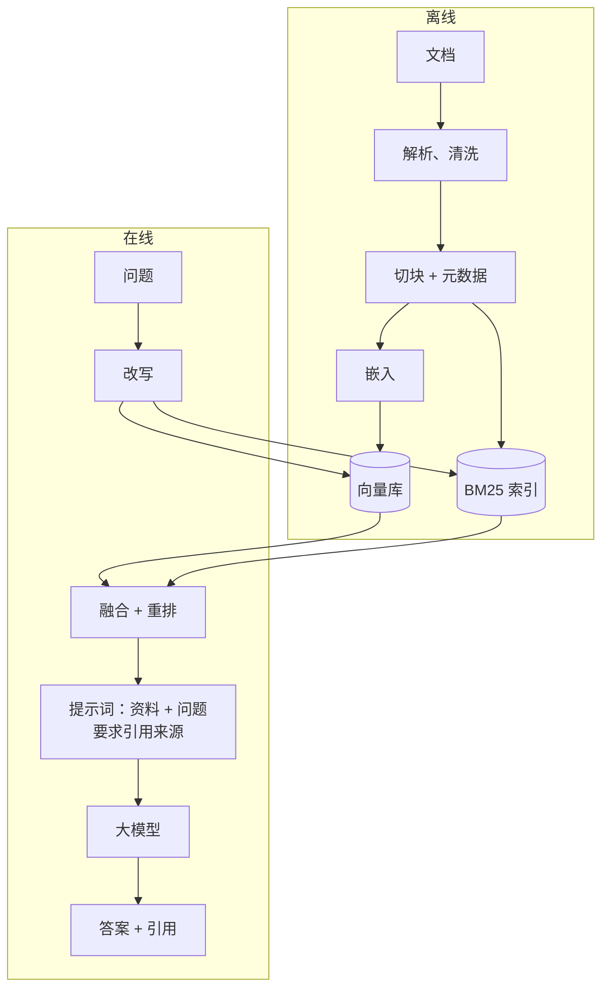

# RAG 的完整流程

> 频率：★★★ · 近两年出现在：字节（RAG 切块、多知识库融合、召回评估）、腾讯（RAG 与混合检索）、美团（RAG 召回指标、向量数据库选型、双向量召回） · 参考：[Anthropic：Contextual Retrieval](https://www.anthropic.com/engineering/contextual-retrieval)

## 一句话答案

**离线**：文档解析（PDF、网页、表格）→ 清洗 → 切块 → 生成向量（嵌入模型）→ 写入向量库（同时建 BM25 索引、存元数据）。**在线**：问题改写 → 检索（向量 + 关键词混合，加元数据过滤）→ 融合、重排 → 拼进提示词（带来源）→ 大模型生成答案并引用来源。RAG 让模型基于**最新的、私有的**资料回答，减少幻觉，资料更新不用重新训练模型。

## 展开（1–2 分钟能讲完）

**每个环节的关键点**：

| 环节 | 关键点 |
|---|---|
| 解析 | PDF 的版面、表格、图片是难点（OCR、版面分析、表格转 Markdown）；解析质量决定上限 |
| 切块 | 见[切块与检索](./chunking-retrieval) |
| 嵌入 | 选适合语言和领域的模型；查询和文档用同一个模型；换模型要重建索引 |
| 索引 | 向量索引（HNSW、IVF）+ 关键词索引 + 元数据（来源、时间、权限、版本） |
| 检索 | 混合检索；**按权限过滤**（用户只能检索到自己有权限的文档）；按时间过滤 |
| 重排 | Cross-Encoder 精排，取前几条 |
| 生成 | 提示词要求基于资料、引用来源、找不到就说明；控制上下文长度 |
| 评估 | 检索和生成分开评估（见[幻觉与评测](./hallucination-eval)） |

**什么时候不用 RAG**：知识量很小（几十页）时直接整个放进上下文（配合提示词缓存）更简单准确；需要学习的是**风格、格式、特定任务的能力**而不是知识时，考虑微调；需要实时数据（股价、订单状态）时直接用工具查询。

## 图解

## 追问链

- **召回效果怎么评估（召回率、MRR、命中率）？** 需要一个评测集：每个问题标注哪些块（或文档）是相关的。
  - **召回率@K**：前 K 个结果里召回了多少比例的相关块。RAG 最关心这个，因为没召回的内容模型一定用不上。
  - **命中率@K**（Hit Rate）：前 K 个里至少有一个相关块的问题占比。
  - **MRR**（平均倒数排名）：每个问题第一个相关结果排名的倒数，再求平均。第一个相关结果排第 1 得 1 分，排第 3 得 1/3。衡量相关结果是否排在前面。
  - **NDCG**：考虑多个相关结果和相关程度的排序质量。
  - 评测集的构建：从真实问题中采样人工标注；或者用 LLM 根据文档块生成问题（块就是答案来源），再人工筛选。
- **知识库更新后缓存和索引的一致性？** 文档更新时要：重新解析、切块、嵌入，**删除旧版本的所有块**（按文档 id 删除，所以每个块要存所属文档 id 和版本号），写入新块；整个过程尽量原子（先写新版本，再切换版本号，最后删旧的），避免中间状态查到一半新一半旧。如果有**问答缓存**（相同或相似问题直接返回缓存的答案），缓存的 key 或元数据里要记录引用的文档 id，文档更新时让相关缓存失效；或者缓存带短 TTL。更新通过 MQ 异步处理，要幂等，失败重试，并监控「文档更新时间」和「索引更新时间」的差距。
- **向量库选型（Milvus、pgvector、ES）？**

  | | 适合 | 特点 |
  |---|---|---|
  | **pgvector** | 数据量百万级以内、已经在用 PostgreSQL | 和业务数据在一起，能用 SQL 做过滤和关联，事务一致；超大规模时性能不如专业向量库 |
  | **Milvus** | 亿级向量、高并发 | 专业向量数据库，分布式，多种索引（HNSW、IVF、DiskANN），存算分离；运维复杂 |
  | **Elasticsearch / OpenSearch** | 已有 ES、需要强大的全文检索 | 原生支持 BM25 + 向量的混合检索，过滤和聚合能力强；向量性能和内存占用不如专业库 |
  | 托管服务（Pinecone 等） | 不想运维 | 按量付费，数据在第三方 |

  选择看：数据规模、是否需要混合检索、团队已有的技术栈、运维能力、数据能否出公司。小项目用 pgvector 或 ES 起步，不要一开始就上分布式向量库。
- **HNSW 是什么？** 最常用的近似最近邻索引：多层图结构，上层稀疏、下层稠密，查询时从顶层开始贪心地找最近的点，逐层下降。查询快、召回率高，但内存占用大、构建慢。

## 我的项目里

TODO：你的 RAG 项目的数据量、用的向量库和嵌入模型、召回率是多少？最大的问题出在哪个环节？
