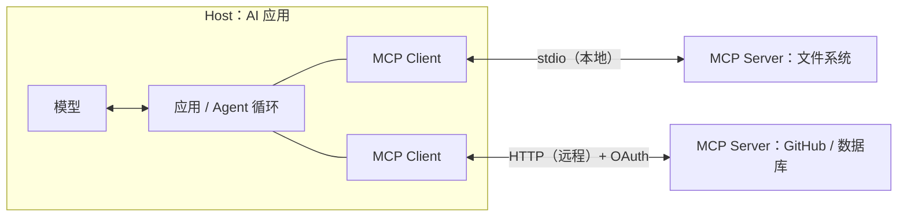

# 工具调用、MCP 与 Skill

> 频率：★★★ · 近两年出现在：字节（Tool 与 Skill、MCP）、阿里（MCP 工具、Agent 网关）、腾讯（Skill 按需加载、Prefix Cache、上下文压缩、长 Tool Result）、美团（Skill 与 Workflow、多 Skill 路由、MCP 装配） · 参考：[Model Context Protocol 文档](https://modelcontextprotocol.io/docs/getting-started/intro)

## 一句话答案

**工具调用（Function Calling）**：把工具的名称、描述和参数的 JSON Schema 交给模型，模型决定调用时输出工具名和参数，由**应用程序**执行后把结果再交给模型。**MCP**（Model Context Protocol）是一个开放协议，规定了 AI 应用（客户端）和工具 / 数据提供方（MCP 服务器）之间怎么通信，一次实现的工具可以被任何支持 MCP 的应用使用。**Skill** 是打包好的「指令 + 脚本 + 资源」，平时只把简短的描述放进上下文，需要时才加载完整内容，用来给 Agent 增加特定领域的能力。

## 展开（1–2 分钟能讲完）

**一次工具调用的流程**：

1. 应用把对话和工具定义发给模型。
2. 模型返回一个工具调用（`name`、`arguments`），而不是最终回答。
3. 应用**校验参数**、检查权限，执行工具（可以并行执行多个调用）。
4. 把结果作为 `tool` 消息追加进对话，再次调用模型。
5. 重复直到模型给出最终回答。

**工具设计的原则**：工具描述要写清楚**什么时候用、什么时候不用**、参数的含义和格式（模型完全依赖描述来决定）；粒度合适（一个工具做一件明确的事，不要几十个功能相近的工具让模型纠结）；返回**对模型有用**的内容（精简、结构化，错误信息要能指导模型修正）；工具数量多时按需加载。

**MCP 的组成**：

- 角色：**Host**（用户使用的 AI 应用，如 IDE、桌面助手）→ 里面的 **Client**（每个连接一个）→ **Server**（提供能力的一方）。
- Server 能提供三类东西：**Tools**（模型可以调用的函数）、**Resources**（可读取的数据，如文件、数据库记录）、**Prompts**（预定义的提示模板）。
- 传输：本地用 **stdio**（启动一个子进程），远程用 **Streamable HTTP**；消息格式是 JSON-RPC 2.0；远程服务器用 OAuth 做授权。

## 图解

## 追问链

- **Function Call 和 MCP 的区别？** 它们在不同的层次：Function Calling 是**模型的能力**和模型 API 的接口格式（模型如何表达「我要调用这个函数」），每家厂商格式略有不同；MCP 是**应用和工具提供方之间的协议**（工具怎么被发现、调用、返回结果、鉴权）。在一个应用内部，MCP 服务器提供的工具最终还是要转成 Function Calling 的格式交给模型。MCP 解决的是 M 个应用 × N 个工具的集成问题：每个工具只要实现一次 MCP Server，所有支持 MCP 的应用都能用，类似于「AI 应用的 USB 接口」。
- **工具调用失败怎么容错（重试、退避、幂等）？** 分类处理：
  - **参数错误**（模型生成的参数不合法）：校验后把**具体的错误信息**返回给模型，让它修正后重试，不要直接抛异常终止。
  - **临时错误**（超时、限流、5xx）：在工具内部**指数退避重试**（带抖动、有上限），对模型透明。
  - **持续失败**：返回明确的失败信息，让模型换一种方法或者告诉用户；配合熔断，避免反复调用一个挂掉的服务。
  - **有副作用的工具**（下单、发消息、写数据库）：必须**幂等**（调用方生成幂等 key，重试时带同一个），否则重试会导致重复操作。
  - 每个工具都要有**超时**；整个 Agent 有最大步数和总时长。
- **工具权限控制？** **最小权限**：只给 Agent 当前任务需要的工具；工具本身用**用户的身份和权限**访问数据（而不是一个超级账号），防止越权；按风险分级：只读操作自动执行，写操作和不可逆操作（删除、转账、发邮件）需要**人工确认**；参数层面的限制（只允许访问某个目录、某些表）；在沙箱里执行代码；所有调用记录审计日志。还要防**提示词注入**：工具返回的内容是不可信的数据，不能让其中的指令触发其他高危工具（见[幻觉与评测](./hallucination-eval)）。
- **Skill 按需加载对 Prefix Cache 的影响？** 提示词缓存（Prefix Cache）只对**完全相同的前缀**生效：系统提示 + 工具定义 + 前面的消息不变，就能复用之前计算的 KV 缓存，降低成本和首 token 延迟。如果把所有 Skill 的完整内容都放进系统提示，前缀很长，而且任何一个 Skill 改动都会让缓存失效。**按需加载**的做法：系统提示里只放所有 Skill 的**简短描述**（稳定、短），模型需要时通过工具读取某个 Skill 的完整内容，作为一条新消息**追加在对话末尾**。这样前缀保持不变，缓存一直有效，加载的 Skill 内容只影响之后的部分。反过来，如果在对话中途**修改系统提示或工具列表**（动态增删工具），前缀就变了，之后的请求全部无法命中缓存，所以动态内容应该追加在后面，而不是插到前面。

## 我的项目里

TODO：你的 Agent 有哪些工具？工具描述是怎么写的？有没有用 MCP？哪些操作需要人工确认？
